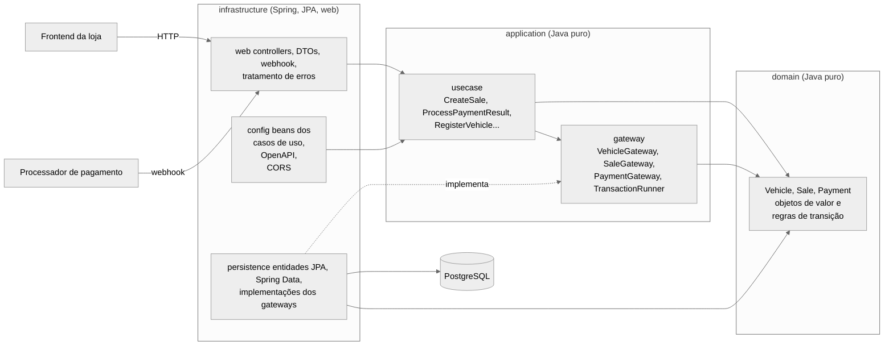
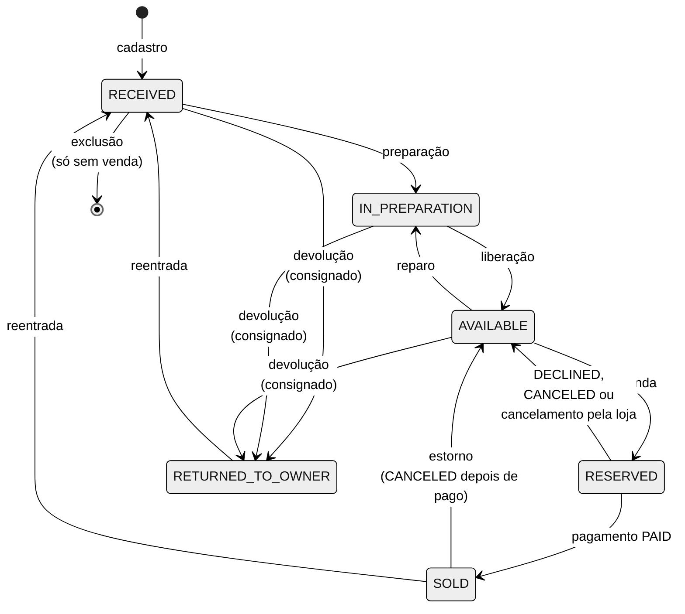
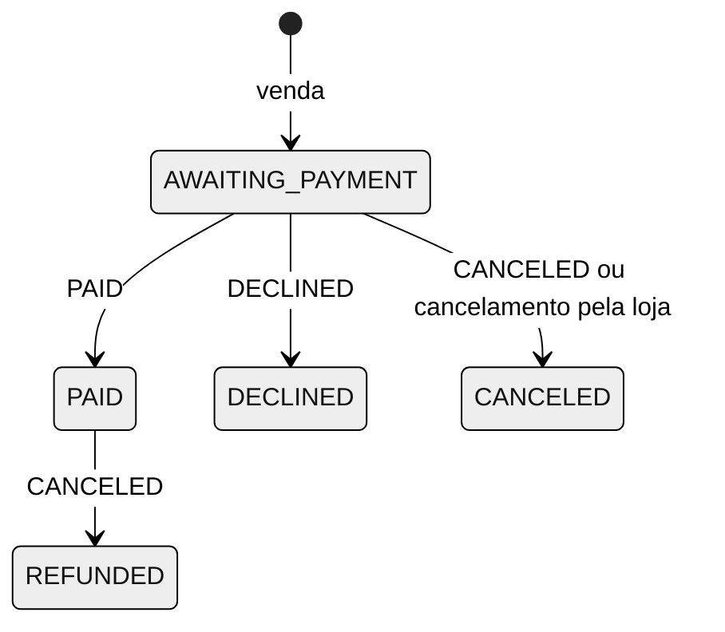

# OmniDrive

API de uma plataforma de revenda de veículos, feita como trabalho substitutivo da Fase 2 do Tech Challenge (SOAT, PósTech FIAP). A loja cadastra e edita veículos, acompanha a preparação até a vitrine, efetua a venda e recebe, por webhook, o resultado do pagamento.

## Sumário

- [Funcionalidades](#funcionalidades)
- [Stack](#stack)
- [Arquitetura](#arquitetura)
- [Modelo de domínio](#modelo-de-domínio)
- [Endpoints](#endpoints)
- [Como rodar](#como-rodar)
- [Como testar](#como-testar)
- [Regras inferidas e premissas](#regras-inferidas-e-premissas)
- [Evoluções futuras](#evoluções-futuras)

## Funcionalidades

Pedidas pelo enunciado:

- Cadastrar um veículo para venda (marca, modelo, ano, cor e preço) e editar os dados dele.
- Efetuar a venda, com o CPF do comprador e a data da venda.
- Listar os veículos à venda e os vendidos, os dois ordenados por preço, do mais barato para o mais caro.
- Receber, por webhook e a partir do código do pagamento, o aviso de que o pagamento foi efetuado ou cancelado.

O enunciado avisa que nem todos os campos e funcionalidades necessários estão descritos. As funcionalidades abaixo entraram porque a solução não funciona direito sem elas. A justificativa de cada uma está em [Regras inferidas e premissas](#regras-inferidas-e-premissas).

- Identificação do veículo por chassi, placa e quilometragem.
- Ciclo de status do veículo: recebido, em preparação, disponível, reservado, vendido e devolvido ao dono (consignado).
- Busca de veículos por placa, chassi, status, marca e modelo.
- Consulta da venda com o status do pagamento e cancelamento da venda pela loja.
- Exclusão de um veículo cadastrado por engano.
- Webhook autenticado por segredo compartilhado.
- Paginação em todas as listagens e CORS para o frontend.

## Stack

- **Java 25** e **Spring Boot 4.1**, com virtual threads
- **PostgreSQL 18**, com o schema versionado pelo **Flyway**
- **springdoc-openapi** (Swagger UI)
- **JUnit 5**, **Mockito**, **Testcontainers** e **ArchUnit**
- **Docker**, **Docker Compose** e **Kubernetes**

## Arquitetura

O código segue a Clean Architecture, com três camadas no topo do pacote `br.com.fiap.omnidrive` e as dependências apontando para o domínio. No diagrama, cada seta sólida é uma dependência no código. A seta tracejada mostra a inversão de dependência: a persistência implementa as interfaces que a aplicação define, e a aplicação nunca enxerga o JPA.



A árvore de pacotes:

```
br.com.fiap.omnidrive
├── domain            Java puro: entidades, objetos de valor e regras de transição
│   ├── common        Money, Cpf
│   ├── vehicle       Vehicle, VehicleDetails, Chassis, Plate, VehicleStatus, VehicleOrigin
│   ├── sale          Sale, Payment, PaymentStatus, PaymentResult
│   └── exception     exceções de regra de negócio
├── application       Java puro, depende só do domínio
│   ├── usecase       um caso de uso por classe, separados por agregado (vehicle, sale)
│   ├── pagination    PageQuery e PageResult
│   └── gateway       interfaces de persistência e TransactionRunner
└── infrastructure    Spring, JPA e web
    ├── web           controllers, DTOs, webhook e tratamento de erros
    ├── persistence   entidades JPA, Spring Data e implementações dos gateways
    └── config        beans dos casos de uso, OpenAPI e WebConfig (CORS e registro do interceptor do webhook)
```

- **Domínio sem framework.** As regras de transição de status ficam nas entidades (`Vehicle`, `Payment`), não nos controllers nem nos casos de uso. `domain` e `application` não têm anotações do Spring nem do JPA.
- **Casos de uso como classes simples** (`CreateSale`, `ProcessPaymentResult` etc.), com um método `execute`, registradas como beans por `@Configuration` na infraestrutura.
- **Persistência atrás de interfaces.** Os casos de uso dependem de `VehicleGateway`, `SaleGateway` e `PaymentGateway`, implementados com JPA. A transação é aberta pelo caso de uso por meio da interface `TransactionRunner`, implementada com o `TransactionTemplate` do Spring.
- **Regra de dependência verificada no build.** O `ArchitectureTest` (ArchUnit) quebra o build se o `domain` usar algo além do Java, se a `application` usar algo além do Java e do domínio, ou se alguma camada acessar a infraestrutura.
- **Concorrência com lock otimista.** Veículo e pagamento têm coluna `version`. Duas operações simultâneas sobre o mesmo registro não se sobrepõem: a segunda recebe 409.
- **Erros no formato Problem Details** (RFC 9457), com mensagens em português: 400 para dado malformado, 401 para segredo do webhook inválido, 404 para recurso inexistente, 409 para conflito de versão ou duplicidade e 422 para regra de negócio violada.

## Modelo de domínio

### Status do veículo



- A **origem** (`OWNED`, próprio da loja, ou `CONSIGNED`, consignado) é um atributo, não um status. Só o consignado pode ser devolvido ao dono.
- O veículo guarda o **valor de entrada** (`purchasePrice`) e o **preço de venda** (`salePrice`). Na venda, o preço é copiado para o valor da venda.
- Os dados só podem ser editados em `RECEIVED`, `IN_PREPARATION` e `AVAILABLE`. O chassi nunca muda.
- O cadastro é único: um veículo vendido que volta à loja entra pela **reentrada**, com novo valor de entrada e quilometragem maior. Por isso um veículo pode ter várias vendas ao longo do tempo, mas no máximo uma ativa.
- Toda mudança de status grava um registro no histórico, com o status anterior, o novo, o motivo e a venda relacionada.

### Status do pagamento



O processador de pagamento é a fonte da verdade. O efeito de cada status no veículo fica no domínio, em `Payment.applyTo`. O webhook é idempotente: repetir uma notificação já aplicada responde 200 sem alterar nada.

## Endpoints

A documentação completa, com exemplos e todas as respostas de erro, está no Swagger UI: `http://localhost:8080/swagger-ui.html` (compose) ou `http://localhost:30080/swagger-ui.html` (Kubernetes). O documento OpenAPI fica em `/v3/api-docs`.

| Método | Rota | Descrição |
|---|---|---|
| `POST` | `/vehicles` | Cadastrar veículo |
| `GET` | `/vehicles/{id}` | Consultar veículo |
| `PUT` | `/vehicles/{id}` | Editar veículo (envia a `version` lida) |
| `DELETE` | `/vehicles/{id}` | Excluir veículo cadastrado por engano |
| `POST` | `/vehicles/{id}/preparation` | Iniciar preparação (ou retirar da vitrine para reparo) |
| `POST` | `/vehicles/{id}/release` | Liberar para venda |
| `POST` | `/vehicles/{id}/return-to-owner` | Devolver o consignado ao dono |
| `POST` | `/vehicles/{id}/readmission` | Registrar reentrada |
| `GET` | `/vehicles` | Buscar por placa, chassi, status, marca e modelo |
| `GET` | `/vehicles/for-sale` | Listar à venda, por preço de venda crescente |
| `GET` | `/vehicles/sold` | Listar vendidos, por valor da venda crescente |
| `POST` | `/sales` | Efetuar venda |
| `GET` | `/sales/{id}` | Consultar venda e status do pagamento |
| `POST` | `/sales/{id}/cancellation` | Cancelar venda enquanto o pagamento aguarda |
| `POST` | `/webhooks/payments` | Informar resultado do pagamento (header `X-Webhook-Secret`) |

As listagens são paginadas com `?page=0&size=20` (máximo de 100 por página) e devolvem `{content, page, size, totalElements, totalPages}`.

## Como rodar

### Docker Compose

Requisito: Docker. As portas **8080** e **5432** precisam estar livres.

```bash
docker compose up
```

O comando constrói a imagem da aplicação a partir do código, sobe o PostgreSQL, espera o banco ficar saudável e inicia a aplicação, que aplica as migrations do Flyway na subida. Nenhum passo manual é necessário antes.

- API e Swagger UI: http://localhost:8080/swagger-ui.html
- Saúde: http://localhost:8080/actuator/health
- Segredo do webhook: `omnidrive-dev-webhook-secret`

Para usar outro segredo ou outras origens de CORS:

```bash
WEBHOOK_SECRET=outro-segredo CORS_ALLOWED_ORIGINS=http://localhost:4200 docker compose up
```

Para parar: `docker compose down`. Com `-v`, também apaga o volume do banco.

### Kubernetes

Os manifestos ficam em `k8s/`: Deployment, ConfigMap, Secret e Service para a aplicação e para o PostgreSQL, além do PersistentVolumeClaim do banco. As imagens estão publicadas no GitHub Container Registry, públicas e para amd64 e arm64:

- `ghcr.io/fredericoffs/omnidrive-app:0.0.1`
- `ghcr.io/fredericoffs/omnidrive-postgres:18`

Em qualquer cluster com acesso à internet:

```bash
kubectl apply -k k8s/
kubectl -n omnidrive rollout status deploy/omnidrive-app
```

Tudo é criado no namespace `omnidrive`: duas réplicas da aplicação e uma do PostgreSQL. A aplicação é exposta por um Service `NodePort` na porta **30080**.

Para testar localmente com o [kind](https://kind.sigs.k8s.io/), use a configuração do repositório, que já mapeia a porta 30080 para a máquina:

```bash
kind create cluster --config k8s/kind-config.yaml
kubectl --context kind-omnidrive apply -k k8s/
kubectl --context kind-omnidrive -n omnidrive rollout status deploy/omnidrive-app
```

- API e Swagger UI: http://localhost:30080/swagger-ui.html
- Segredo do webhook: `omnidrive-k8s-webhook-secret` (Secret `omnidrive-app-secret`)
- Para apagar o cluster: `kind delete cluster --name omnidrive`

Detalhes da implantação:

- As configurações vêm do ConfigMap (URL do banco e origens de CORS) e dos Secrets (credenciais do banco e segredo do webhook). A aplicação lê usuário e senha do Secret do PostgreSQL, para o valor existir num lugar só.
- Um initContainer espera o PostgreSQL aceitar conexões antes de iniciar a aplicação.
- As probes de liveness e readiness usam os endpoints do Actuator (`/actuator/health/liveness` e `/actuator/health/readiness`).
- Os containers rodam sem root (UID 1001 na aplicação, 70 no PostgreSQL), com requests e limites de CPU e memória.

### Sem Docker para a aplicação

Requisitos: Java 25 e um PostgreSQL acessível. As variáveis `DB_URL`, `DB_USERNAME` e `DB_PASSWORD` têm como padrão `jdbc:postgresql://localhost:5432/omnidrive`, `omnidrive` e `omnidrive`, que batem com o banco do compose.

```bash
docker compose up postgres      # só o banco
./mvnw spring-boot:run
```

Ou, com o PostgreSQL criado pelo Testcontainers (precisa só do Docker):

```bash
./mvnw spring-boot:test-run
```

## Como testar

### Testes automatizados

```bash
./mvnw clean verify
```

São 468 testes. Os de integração usam o Testcontainers, então o Docker precisa estar rodando.

- **Domínio:** regras de transição, objetos de valor (chassi, placa, CPF, dinheiro) e o efeito de cada pagamento no veículo.
- **Casos de uso:** com Mockito nos gateways.
- **Web:** controllers com `@WebMvcTest`, cobrindo validação, códigos de status e o formato dos erros.
- **Persistência:** gateways JPA contra o PostgreSQL real (paginação, ordenação, busca, unicidade e lock otimista).
- **Transações e concorrência:** rollback sem gravação parcial, duas vendas simultâneas do mesmo veículo, dois webhooks iguais simultâneos e cancelamento da loja simultâneo a um webhook.
- **Ponta a ponta:** a API completa contra o PostgreSQL, do cadastro à venda, ao webhook, à revenda e às probes de saúde.
- **Arquitetura:** a regra de dependência entre as camadas, com ArchUnit.

### Testando manualmente

O caminho mais simples é o Swagger UI. Um fluxo completo pelo `curl`, com a aplicação no compose:

```bash
# 1. Cadastrar
curl -s -X POST localhost:8080/vehicles -H 'Content-Type: application/json' -d '{
  "chassis": "9BWZZZ377LT004251", "plate": "ABC1D23", "mileage": 45000,
  "brand": "Fiat", "model": "Uno", "year": 2020, "color": "Prata",
  "purchasePrice": 30000, "salePrice": 40000, "origin": "OWNED"
}'

# 2. Preparar e liberar (use o id devolvido no cadastro)
curl -s -X POST localhost:8080/vehicles/{id}/preparation
curl -s -X POST localhost:8080/vehicles/{id}/release

# 3. Listar à venda
curl -s localhost:8080/vehicles/for-sale

# 4. Vender (guarde o paymentCode da resposta)
curl -s -X POST localhost:8080/sales -H 'Content-Type: application/json' -d '{
  "vehicleId": "{id}", "buyerCpf": "529.982.247-25", "saleDate": "2026-10-06"
}'

# 5. Informar o pagamento, como faria o processador
curl -s -X POST localhost:8080/webhooks/payments \
  -H 'Content-Type: application/json' \
  -H 'X-Webhook-Secret: omnidrive-dev-webhook-secret' \
  -d '{"paymentCode": "{paymentCode}", "status": "PAID"}'

# 6. Listar vendidos
curl -s localhost:8080/vehicles/sold
```

No Kubernetes, troque a porta por 30080 e o segredo por `omnidrive-k8s-webhook-secret`.

## Regras inferidas e premissas

### Funcionalidades inferidas

O critério foi "a solução funciona sem isso?". Entraram as funcionalidades sem as quais algum fluxo do enunciado não se completa.

- **Chassi, placa e quilometragem.** Marca, modelo, ano e cor não identificam um veículo, e sem um identificador o mesmo carro poderia ser cadastrado duas vezes. O chassi é único e não editável. Um chassi de 17 caracteres é tratado como VIN, com o código do ano conferido. Veículos até 1986 podem ter chassi em outro formato. A placa é única, no padrão antigo ou no Mercosul.
- **Preparação e liberação antes da vitrine.** Todo veículo passa por recebido, em preparação e disponível, um endpoint por passo. Só o disponível aparece na listagem à venda, e um disponível pode voltar à preparação para reparo.
- **Devolução do consignado.** Sem ela, um consignado retirado pelo dono continuaria na vitrine.
- **Reentrada.** Um veículo vendido (ou devolvido ao dono) que volta à loja reaproveita o mesmo cadastro, com novo valor de entrada e quilometragem maior. Vindo de devolvido ao dono, a quilometragem pode ser igual.
- **Busca de veículos.** Sem ela, um veículo recebido, em preparação ou reservado não aparece em nenhuma listagem, e o frontend não tem como chegar até ele.
- **Consulta da venda.** É como o frontend acompanha o status do pagamento depois de vender.
- **Cancelamento da venda pela loja.** Sem ele, uma desistência deixaria o veículo reservado até o processador se manifestar. Só é aceito enquanto o pagamento aguarda.
- **Exclusão do cadastro errado.** Como o chassi não é editável, um chassi digitado errado deixaria o veículo preso. Só vale para o veículo recebido que nunca teve venda.
- **Webhook autenticado.** Sem autenticação, qualquer um que conhecesse a rota poderia marcar um pagamento como pago. A chamada exige o header `X-Webhook-Secret`, e o valor vem de variável de ambiente (Secret no Kubernetes).
- **CORS.** O frontend roda em outra origem. As origens permitidas vêm de configuração.
- **Paginação.** Boa prática para listas que só crescem, com desempate pelo id para a ordem não mudar entre as páginas.

### Regras de negócio inferidas

- O ano do veículo fica entre 1900 e o ano seguinte ao atual (ano-modelo).
- A data da venda pode estar no passado, mas não no futuro.
- O CPF é validado pelos dígitos verificadores, aceito com ou sem pontuação e guardado só com os dígitos.
- A listagem de vendidos mostra a venda atual de cada veículo. Depois da reentrada, ele sai da listagem e a venda anterior fica no histórico.

### Premissas

- **Autenticação dos usuários da loja.** A API não tem login próprio: ela roda atrás de um API gateway ou da autenticação da plataforma.
- **Código do pagamento.** A API gera o código (UUID) ao criar a venda. A loja o repassa ao processador, que informa o resultado pelo webhook usando esse código.
- **Valor da venda.** É o preço de venda anunciado. Para negociar, a loja edita o preço antes de vender.
- **Estados terminais do pagamento.** Recusado, cancelado e estornado são terminais. Um evento que contradiz um deles (por exemplo, `PAID` depois de cancelado) recebe 422 e precisa de tratamento manual.
- **Estorno.** `CANCELED` depois de pago devolve o veículo à venda. A premissa é que o processador só envia esse cancelamento quando o veículo não foi entregue, ou já voltou à loja e está apto a ser vendido.
- **Webhook de uma venda antiga.** Se o veículo já foi revendido, o resultado de uma venda anterior só muda o pagamento dela, não o veículo.
- **Cancelamento pela loja.** A loja também cancela a cobrança no processador. Um `PAID` que chegue depois recebe 422.
- **Segredos.** Os Secrets do Kubernetes e os valores padrão do compose são de demonstração. Em produção, viriam de um cofre de segredos.
- **PostgreSQL no Kubernetes.** Roda num Deployment com uma réplica e volume persistente, como pede a lista de recursos do enunciado. Com mais de uma réplica, o correto seria um StatefulSet ou um banco gerenciado.

## Evoluções futuras

- **Consulta do histórico e das vendas de um veículo.** Os dados já são gravados. Faltam os endpoints, como `GET /vehicles/{id}/history` e `GET /vehicles/{id}/sales`.
- **Baixa de veículo.** Hoje só se exclui o cadastro errado. Um veículo com venda nunca sai do sistema, e uma baixa (sinistro, perda total, descarte) pode virar um status ou uma exclusão lógica.
- **Reconciliação de pagamentos.** Os eventos contraditórios que hoje recebem 422 poderiam ir para uma fila de exceções ou ser conciliados com o processador.
- **Formas de pagamento.** Financiamento, consórcio e pagamento parcial ficaram fora do escopo.
